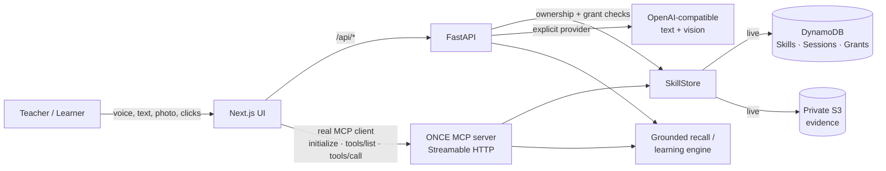

# ONCE: Devpost submission packet

**Track:** Alexa+ (simulated-experience path with a self-hosted MCP server)
**Mini challenge:** AWS Builder
**Repo:** https://github.com/khushi-infinity/once
**License:** MIT
**Demo video:** add the public YouTube/Vimeo URL before submitting

---

## One-line pitch

**ONCE is a personal skill-memory: teach it how *you* do something once, and it
guides the next person through it, with grounded answers, a real DOM
highlight, and proof when a step actually happened.**

## The problem

The most useful knowledge in a family or a team is tacit: how Dad packs for a
conference, how a teammate shares a photo on a legacy internal site, how a
caregiver closes up the house. Today that knowledge lives in one person's head
or in a screen recording nobody can follow. General assistants can remember
facts, but they cannot reliably teach a *method* and verify that someone
actually did it.

ONCE is built around one promise: **teach once, let it teach anyone, forever.**
The original user teaches by voice, text, photo, or by demonstrating a browser
workflow. ONCE stores a structured skill. Later, the owner or an authorized
learner can ask for it, follow it, and get honest feedback when reality differs
from what was taught.

## What the product does

| Journey | What happens |
| --- | --- |
| **Teach a bag / checklist** | Speak, type, or show a photo. The model proposes an editable draft. Nothing is stored until the human confirms it. The confirmed skill is written to DynamoDB. A draft taught through `/alexa` is handed to the same review screen, so the MCP path ends in a real save instead of a dead link. |
| **Ask "what am I missing?"** | ONCE retrieves the *stored* skill, compares required items with what the reader explicitly confirms, and reports the rest as **not confirmed**, never as proof of absence. |
| **Teach a browser workflow** | Record real clicks in the PhotoShare demo app. Each step stores a stable DOM element id and expected event. |
| **Guide a second learner** | The learner view outlines the exact recorded control in the live DOM. The server verifies the clicked element; a wrong click returns a mismatch and does **not** advance. |
| **Ask by voice through MCP** | The `/alexa` page is a real Streamable HTTP MCP client. It negotiates the protocol, lists the tool surface, and calls `once_recall_missing`, `once_start_session`, etc. The UI shows the actual JSON-RPC arguments and results. |

## The Alexa+ track: what is actually real

Amazon's FAQ for this hackathon states that the Alexa+ Add-on developer tools
(Category SDK, MCP Toolkit, CLI, Web Simulator) are in select-partner preview
and **cannot be accessed by hackathon participants**. The allowed path is a
self-hosted MCP server (spec 2025-11-25+, Streamable HTTP) or an Agent Skill,
demoed through your own web simulator or front end.

ONCE takes that path literally:

1. `backend/app/mcp_server.py` is a real MCP server exposing **8 tools** over
   **Streamable HTTP**.
2. `/alexa` is a real MCP client. It sends `initialize`, the
   `notifications/initialized` notification, `tools/list`, and `tools/call`.
   The page displays the negotiated protocol version (**2025-11-25**), the tool
   count, and the raw tool arguments/result for every answer.
3. The server and the HTTP API share the same store, authorization checks, and
   grounded-recall logic. There is no privileged back door for the demo.
4. The MCP server can be run and inspected independently with
   `backend/scripts/mcp_smoke.py` (official Python MCP client, 8 checks).

**No Alexa+ SDK access, Add-on tooling, or real-device integration is claimed.**
The page says so in the UI. What *is* real is the MCP transport, the protocol
handshake, the tools, the storage, and the answers.

## The AWS Builder story: what is actually real

| Service | Use in ONCE | Evidence |
| --- | --- | --- |
| **Amazon DynamoDB** | `ONCE_Skills`, `ONCE_Sessions`, `ONCE_Grants`, skills, learner progress, share grants; on-demand tables + GSIs; queries only, no scans | `scripts/smoke_live.py`, live pytest |
| **Amazon S3** | Private evidence bucket for consented teaching artifacts; Public Access Block on all four switches, SSE-S3, no bucket policy | `s3_private_roundtrip` + public-read denial check |
| **AWS IAM** | Backend runs as the least-privilege `once-local` identity; policy committed at `backend/scripts/once-runtime-iam-policy.json` | `sts:GetCallerIdentity` smoke check |
| **AWS STS** | Identity verification in the live smoke test | `aws_identity` check |

Reproduce:

```bash
cd backend
APP_MODE=live AWS_PROFILE=once-local uv run python scripts/smoke_live.py
# 4/4 PASS: identity, DynamoDB skill, DynamoDB session, private S3 roundtrip
```

```bash
cd backend
APP_MODE=live AWS_PROFILE=once-local uv run pytest -q
# 19 passed
```

The frontend never receives AWS credentials. All AWS calls happen server-side
through the standard credential chain.

## Inference (explicit, not AWS AI)

Inference runs through one explicitly selected OpenAI-compatible endpoint (local
Ollama by default, or any hosted compatible endpoint). Every extraction response
carries sanitized `engine` metadata and `/health` reports the active provider.
Mock mode is a labeled deterministic parser, not a hidden model.

A Gemini adapter is also implemented: `GEMINI_MODEL_ID=gemini-3.8-flash` with
`gemini-3.5-flash-lite` as the availability fallback, bounded retries, and a
real smoke test (`backend/scripts/gemini_smoke.py`). The developer's current
Google AI Studio project lists both models but returns `403 PERMISSION_DENIED`
for generation, so the demo does not claim Gemini is active. The runtime stays
on the explicit local Ollama path, and the adapter is ready once project access
is granted.

ONCE does **not** claim AWS AI usage. The AWS story is the verified data layer:
DynamoDB, S3, and least-privilege IAM. The account-level model-access constraint
that shaped this choice is documented with evidence in `FRICTION_LOG.md`.

## Architecture



Key invariants:

- Memory is retrieval, not generation. The model may draft a skill; it may not
  alter or invent a stored answer.
- `not_confirmed ≠ missing`. Unconfirmed items are never presented as proof of
  absence.
- Ownership and sharing are enforced server-side. A stranger gets a 404, not an
  existence leak.
- Guidance targets real DOM. The server verifies the clicked element id before
  advancing a learner session.
- Failure is never masked. Live-mode failures surface as errors; mock mode is
  opt-in and labeled.

## What is real vs. simulated (judge cheat sheet)

| Thing | Status |
| --- | --- |
| MCP server with 8 tools over Streamable HTTP | **Real**, spec 2025-11-25 |
| Browser page acting as an actual MCP client | **Real** (`/alexa`), with visible JSON-RPC transcript |
| DynamoDB skills, sessions, grants | **Real** (live mode) |
| Private S3 evidence roundtrip | **Real** (live mode) |
| Browser-workflow DOM highlight + target-aware verification | **Real** |
| Voice input / spoken replies | **Real browser Web Speech APIs**; no cloud voice service is claimed |
| Alexa+ Add-on SDK / real Alexa+ device | **Not used and not claimed**, select-partner preview |
| AWS AI inference | **Not used and not claimed**, inference is explicit local/hosted OpenAI-compatible |
| Demo identities (`demo-teacher`, `demo-learner`) | **Demo labels**, not authentication; production would use Cognito or another identity provider |

## How we built it

FastAPI owns the HTTP API, the stores, authorization, recall, and the learner
engine. The MCP app is mounted in the same process at `/mcp` and calls those
same services, there is no privileged demo path. The Next.js app talks to the
API through same-origin rewrites; the browser never receives AWS credentials.
`/alexa` implements the Streamable HTTP MCP handshake directly in the browser
library, so the protocol and tool traffic on screen are real.

The hard part was restraint: when inference was unavailable, the app had to say
so rather than invent a draft; when a required item was not confirmed, it had to
say **not confirmed**, not "missing"; when a learner clicked the wrong DOM
element, the step had to stay put. Those constraints are enforced server-side
and covered by tests.

## Challenges we ran into

- **Alexa+ Add-on tooling is select-partner only.** The hackathon FAQ allows a
  self-hosted MCP server or Agent Skill, so we built a real MCP server and a
  real browser MCP client instead of claiming SDK access. The UI says this
  plainly.
- **Account-level model access was blocked.** We removed the dead dependency
  instead of shipping a fake fallback; inference is now one explicit provider,
  labeled in every response. The evidence is in `FRICTION_LOG.md`.
- **Gemini generation is denied at the project level.** Model listing returns
  200 for `gemini-3.8-flash` and `gemini-3.5-flash-lite`, but every generation
  request returns `403 PERMISSION_DENIED: Your project has been denied access`.
  We implemented the adapter and smoke test, did not fake a successful
  migration, and kept the working local model for the demo. The command and
  honest result are in `TESTING.md`.
- **MCP result parsing is not uniform.** List tools return multiple text blocks
  plus `structuredContent`; the first browser client treated the result as a
  string. We fixed the client to prefer `structuredContent` and unwrap the
  single-result shape.
- **Honest recall semantics.** "What am I missing?" is the user's question, but
  the data can only prove what was *not confirmed*. We renamed the field and
  every UI label accordingly.

## Accomplishments

- 8 MCP tools over Streamable HTTP, verified by an independent Python client
  (8/8) and by the in-browser client.
- 19 live tests, 17 mock tests, `ruff` clean, ESLint clean, production build
  clean.
- Live AWS smoke 4/4: scoped IAM identity, DynamoDB skill, DynamoDB session,
  private S3 roundtrip.
- A second learner is guided by a real DOM highlight and server-side
  target-aware verification, not a screenshot or a scripted animation.
- One command runs the whole app offline (`APP_MODE=mock ./scripts/dev.sh`) with
  seeded demo skills, so a judge can inspect it without AWS or Ollama.

## Built with

- Next.js 16, TypeScript, Tailwind CSS 4
- FastAPI, Pydantic 2, Python 3.14
- MCP Python SDK, Streamable HTTP transport (protocol `2025-11-25`)
- Amazon DynamoDB, Amazon S3, AWS IAM (least-privilege runtime identity)
- Ollama (`qwen2.5-coder:7b` text, `qwen2.5vl:3b` vision) as the explicit local
  inference path
- Playwright for end-to-end checks (browser highlight, wrong-click rejection,
  MCP traffic, no console errors)

## What's next

- Replace demo identity labels with Cognito (or another IdP) and consent-scoped
  sharing with an audit trail.
- Let teachers attach photo evidence to a packing item and verify it with a
  vision model, without letting the model write to storage.
- Host a public demo with a managed OpenAI-compatible endpoint, while keeping
  the same explicit mock/live split.
- Add skill import/export and a version diff so a family or team can review how
  a method changed over time.

## Judge quickstart

Prerequisites: Node 22+, [uv](https://docs.astral.sh/uv/), and Ollama only if
you want to exercise live teach extraction. The curated demo skills are already
in DynamoDB, so recall and guided learning work without Ollama.

```bash
# 1. Backend API (port 8000): also serves MCP at /mcp
cd backend && uv sync
APP_MODE=live AWS_PROFILE=once-local uv run uvicorn app.main:app --port 8000

# 2. Frontend (port 3000)
cd frontend && npm install && npm run dev
```

Or:

```bash
./scripts/dev.sh                 # live AWS mode
APP_MODE=mock ./scripts/dev.sh   # offline: seeded demo skills, no AWS/Ollama
```

Open:

- `/`, teach by voice, text or photo; the event-bag journey.
- `/recall`, grounded "what am I missing?".
- `/alexa`, real MCP client + voice; inspect the actual tool calls.
- `/demo/photoshare`, teach a workflow by demonstration, then guide a learner.

If you do not have the AWS profile, run `APP_MODE=mock` for the store. The UI
labels mock mode; it does not silently pretend to be live.

## Judging criteria: how ONCE maps

### Technical Implementation

- Real MCP server and a real browser MCP client, not a mock transcript.
- DynamoDB/S3 persistence, least-privilege IAM, server-side authorization.
- Deterministic recall and a target-aware learning state machine.
- 19 live tests, 17 mock tests, ruff clean, ESLint clean, production build clean.
- Explicit provider selection, no silent fallback; honest errors.

### Design

- Warm cream/blue interface designed mobile-first, with a consistent orb, card,
  and typography system.
- Voice-first entry points, large controls, captions, keyboard support, and
  reduced-motion handling.
- The interface becomes the task: a packing skill becomes a checklist, a browser
  workflow becomes a live highlight.
- The MCP page exposes the protocol without making the user read a developer
  console: a conversational surface plus an optional traffic drawer.

### Potential Impact

- **Family knowledge transfer:** an older relative's routines, medication
  checklists, or "how I close up the house" can be preserved and guided.
- **Team onboarding:** a teammate records a legacy internal workflow once; the
  next person follows it with verified steps instead of a stale wiki page.
- **Accessibility:** voice-first teaching and spoken step repetition lower the
  barrier for users who cannot read a long procedure.
- **Trust:** the "not confirmed" semantics make the assistant useful for
  high-stakes checklists without overclaiming certainty.

### Quality of the Idea

Most assistants remember facts or generate instructions. ONCE stores a
*personal method*, retrieves it deterministically, and verifies that a learner
actually performed the recorded action. The combination of grounded memory,
real DOM guidance, and a real MCP surface is the creative bet.

## Demo video beats (under 3 minutes)

See `DEMO_SCRIPT.md` for the full shot list. The highest-value order:

1. **0:00-0:12**, Hook: "Alexa remembers facts. ONCE remembers how *you* do
   things, and proves the next person did it."
2. **0:12-0:42**, `/alexa`: ask by voice; show MCP connected, protocol
   2025-11-25, 8 tools; ask "what am I missing for the conference?"; open the
   MCP traffic drawer and show the real `once_recall_missing` call/result.
3. **0:42-1:12**, `/recall`: tick two items; show "not confirmed" language and
   the honesty line. Do **not** say "definitely missing."
4. **1:12-2:12**, `/demo/photoshare`: teach by showing, **Save and help
   Grandma**; a wrong click is rejected; the highlighted control verifies;
   complete the workflow.
5. **2:12-2:37**, Terminal: `smoke_live.py` 4/4 PASS; name DynamoDB, S3, IAM.
6. **2:37-2:55**, Close on the promise + repo. Hard stop before 3:00. Do not
   claim AWS AI or Alexa+ SDK access.

## Product feedback

The full friction log is in `FRICTION_LOG.md`. It includes:

- Bedrock's account-level restriction being invisible in the console and
  un-self-serve-able (with the quota evidence).
- `aws login` resolving to root for personal accounts and blocking the
  "login then assume a scoped role" pattern.
- Alexa+ Add-on tools being select-partner only, with no application path for
  hackathon participants (the FAQ confirms this; the allowed path is a
  self-hosted MCP server).
- MCP SDK/API sharp edges encountered while wiring the real browser client.

Each entry includes what we tried, expected vs. actual, severity, workaround,
and an actionable suggestion.

## Known limitations (stated, not hidden)

- Demo identities are labels, not authentication. Production needs Cognito or
  another IdP; the server-side authorization checks are real for the chosen id.
- Browser guided learning is intentionally limited to the controlled PhotoShare
  app. It does not automate arbitrary third-party sites or use OS-level overlays.
- Live teach extraction depends on a local Ollama model or a configured hosted
  OpenAI-compatible endpoint. If inference is unavailable, the API returns an
  honest 502/503; it does not fake a draft.
- The Gemini 3.8 Flash / 3.5 Flash-Lite adapter is implemented and unit-tested,
  but the current Google AI Studio project returns `403 PERMISSION_DENIED` for
  generation even though model listing succeeds. The demo therefore does not
  claim Gemini is active; `scripts/gemini_smoke.py` reports the real failure.
- The MCP server is mounted in the FastAPI process (a standalone process is
  also available for the independent smoke client). The Next.js rewrite proxies
  `/mcp` to it for same-origin browser calls.
- No public hosted URL is required by the hackathon FAQ; the repo and video are
  the submission.

## Submission checklist

- [ ] Public GitHub repo with MIT license (this repo).
- [ ] Demo video under 3 minutes, public on YouTube or Vimeo, English.
- [ ] Devpost text description (this document is the source).
- [ ] Track selected: **Alexa+**.
- [ ] Mini challenge selected: **AWS Builder**.
- [ ] Product feedback answers (use `FRICTION_LOG.md`).
- [ ] If the form asks for a URL: add a hosted demo only if it is genuinely
      working; otherwise point to the local run instructions. The FAQ says a
      locally runnable public repo plus video is enough.
- [ ] Re-check that no unverified claim (Bedrock, AWS AI, Alexa+ SDK access)
      appears in the video or text.
