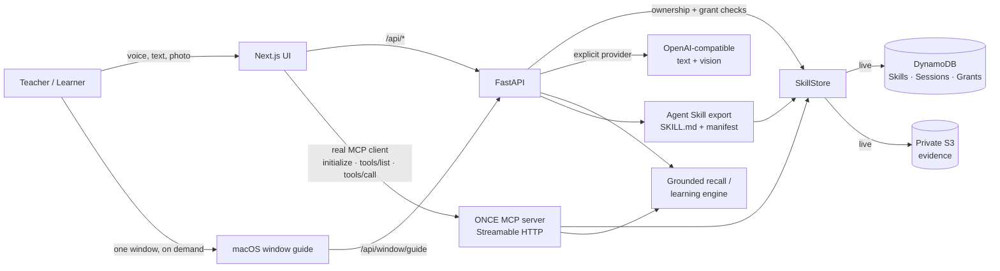

# ONCE: Devpost submission packet

**Track:** Alexa+ (simulated-experience path with a self-hosted MCP server)
**Mini challenge:** AWS Builder
**Repo:** https://github.com/khushi-infinity/once
**Live demo (AWS App Runner):** https://nrsvfngagk.us-east-1.awsapprunner.com
**Public MCP endpoint:** https://nrsvfngagk.us-east-1.awsapprunner.com/mcp
**Backend health:** https://m7ypexbma7.us-east-1.awsapprunner.com/health
**Fallback demo:** https://once-skill-memory.onrender.com
**License:** MIT
**Demo video:** add the public YouTube/Vimeo URL before submitting

> **Scope note (2026-10-22):** the PhotoShare browser-workflow demo was removed
> at product direction. The shipped submission demonstrates the event-bag,
> grounded-recall, shared-skill, portable Agent Skill export, real MCP path,
> and a native macOS window guide. The old browser learning engine remains
> backend-only and is not exposed in the UI.

---

## One-line pitch

**ONCE is a personal skill-memory: teach it how *you* do something once, then
retrieve it with grounded recall, ask a Mac window guide where something is,
and export the method as a portable skill that AI agents can save.**

## The problem

The most useful knowledge in a family or a team is tacit: how Dad packs for a
conference, how a teammate closes the shop, how a caregiver closes up the
house. Today that knowledge lives in one person's head or in a note nobody can
find. General assistants can remember facts, but they cannot reliably preserve
a personal *method* and answer from it.

ONCE is built around one promise: **teach once, let it teach anyone, forever.**
The original user teaches by voice, text, or photo. ONCE stores a structured
skill. Later, the owner or an authorized
learner can ask for it, follow it, and get honest feedback when reality differs
from what was taught.

## What the product does

| Journey | What happens |
| --- | --- |
| **Teach a bag / checklist** | Speak, type, or show a photo. The model proposes an editable draft. Nothing is stored until the human confirms it. The confirmed skill is written to DynamoDB. A draft taught through `/alexa` is handed to the same review screen, so the MCP path ends in a real save instead of a dead link. |
| **Ask "what am I missing?"** | ONCE retrieves the *stored* skill, compares required items with what the reader explicitly confirms, and reports the rest as **not confirmed**, never as proof of absence. |
| **Share a skill** | The owner can share a stored skill with Grandma and revoke access at any time. Sharing is enforced server-side. |
| **Ask about a Mac window** | A native menu bar helper captures one window when the user presses **Look at this window**, sends that screenshot to the configured vision model, and answers questions such as "where is Export?" or "how do I find this file?" The answer can be saved as a `desktop_workflow` skill. |
| **Save for AI agents** | Any readable skill exports as a portable `SKILL.md` plus JSON manifest, or a zip folder, from the web UI or the `once_get_agent_skill` MCP tool. An agent can save the folder in its own skills directory. |
| **Ask by voice through MCP** | The `/alexa` page is a real Streamable HTTP MCP client. It negotiates the protocol, lists the tool surface, and calls `once_recall_missing`, `once_get_skill`, `once_get_agent_skill`, and `once_extract_draft`. The UI shows the actual JSON-RPC arguments and results. |

## The Alexa+ track: what is actually real

Amazon's FAQ for this hackathon states that the Alexa+ Add-on developer tools
(Category SDK, MCP Toolkit, CLI, Web Simulator) are in select-partner preview
and **cannot be accessed by hackathon participants**. The allowed path is a
self-hosted MCP server (spec 2025-11-25+, Streamable HTTP) or an Agent Skill,
demoed through your own web simulator or front end.

ONCE takes that path literally:

1. `backend/app/mcp_server.py` is a real MCP server exposing **9 tools** over
   **Streamable HTTP**.
2. `/alexa` is a real MCP client. It sends `initialize`, the
   `notifications/initialized` notification, `tools/list`, and `tools/call`.
   The page displays the negotiated protocol version (**2025-11-25**), the tool
   count, and the raw tool arguments/result for every answer.
3. The server and the HTTP API share the same store, authorization checks, and
   grounded-recall logic. There is no privileged back door for the demo.
4. The MCP server can be run and inspected independently with
   `backend/scripts/mcp_smoke.py` (official Python MCP client, 9 checks).

**No Alexa+ SDK access, Add-on tooling, or real-device integration is claimed.**
The page says so in the UI. What *is* real is the MCP transport, the protocol
handshake, the tools, the storage, and the answers.

## The AWS Builder story: what is actually real

| Service | Use in ONCE | Evidence |
| --- | --- | --- |
| **Amazon DynamoDB** | `ONCE_Skills`, `ONCE_Sessions`, `ONCE_Grants`, skills, learner progress, share grants; on-demand tables + GSIs; queries only, no scans | `scripts/smoke_live.py`, live pytest |
| **Amazon S3** | Private evidence bucket for consented teaching artifacts; Public Access Block on all four switches, SSE-S3, no bucket policy | `s3_private_roundtrip` + public-read denial check |
| **AWS IAM** | The running backend uses `once-apprunner-backend-instance`, scoped to the three tables, the evidence bucket, and one Secrets Manager secret; policy committed at `backend/scripts/once-runtime-iam-policy.json` | `sts:GetCallerIdentity` smoke check, live data reads/writes |
| **AWS STS** | Identity verification in the live smoke test | `aws_identity` check |
| **Amazon ECR** | Stores the `linux/amd64` backend and frontend images | `describe-images` and running App Runner services |
| **AWS App Runner** | Serves both public containers with managed HTTPS URLs and health checks | `https://nrsvfngagk.us-east-1.awsapprunner.com`, `https://m7ypexbma7.us-east-1.awsapprunner.com` |
| **AWS Secrets Manager** | Stores the OpenRouter key; injected as an App Runner runtime secret | App Runner service configuration; no key in either image |
| **Amazon CloudWatch Logs** | App Runner service logs for the deployed containers | `/aws/apprunner/once-backend/...` and `/aws/apprunner/once-frontend/...` |

Reproduce:

```bash
cd backend
APP_MODE=live AWS_PROFILE=once-local uv run python scripts/smoke_live.py
# 4/4 PASS: identity, DynamoDB skill, DynamoDB session, private S3 roundtrip
```

```bash
cd backend
APP_MODE=live AWS_PROFILE=once-local uv run pytest -q
# 25 passed, 1 skipped
```

The frontend never receives AWS credentials. All AWS calls happen server-side
through the standard credential chain.

The public AWS deployment is two App Runner services in `us-east-1`, built from
ECR images. The backend instance role is `once-apprunner-backend-instance`; the
frontend has no instance role. The OpenRouter key is a Secrets Manager runtime
secret, not a plain environment variable. The remote MCP smoke passes **9/9**
through the frontend proxy, and real text and vision calls were verified against
the AWS backend.

Bootstrap caveat: the App Runner, ECR, IAM, and Secrets Manager resources were
created while signed in as the account root identity because that was the only
identity with create permissions available at the deadline. The running
services do not use root. A long-lived deployment should replace the bootstrap
session with a scoped deployment role.

## Inference (explicit, not AWS AI)

Inference runs through an explicitly selected provider. Every extraction
response carries sanitized `engine` metadata and `/health` reports the active
provider plus any configured fallback. Mock mode is a labeled deterministic
parser, not a hidden model.

The active demo path is `openrouter` with `google/gemini-3.8-flash` for both
text and vision. Real text and image calls have been verified. Output is capped
at 2048 tokens so the hosted request fits the key's credit preflight. Local
Ollama (`qwen2.5-coder:7b` text, `qwen2.5vl:3b` vision) is the optional local
path and the explicit fallback in the developer env.

An optional `INFERENCE_FALLBACK_PROVIDER` is supported. It runs only on a
provider-level failure and the result names the primary in
`engine.fallback_from`; the UI shows the failover. It is never silent and never
substitutes mock output.

A direct Gemini adapter is also implemented: `GEMINI_MODEL_ID=gemini-3.8-flash`
with `gemini-3.5-flash-lite` as the model-availability fallback, bounded
retries, and a real smoke test (`backend/scripts/gemini_smoke.py`). The
developer's current Google AI Studio project lists both models but returns
`403 PERMISSION_DENIED` for generation, so the demo does not claim Gemini is
active. OpenRouter is the working cloud path until project access is granted.

ONCE does **not** claim AWS AI usage. The AWS story is the verified data and
deployment layer: DynamoDB, S3, App Runner, ECR, Secrets Manager, and
least-privilege IAM. The account-level model-access constraint that shaped this
choice is documented with evidence in `FRICTION_LOG.md`.

## Architecture



Key invariants:

- Memory is retrieval, not generation. The model may draft a skill; it may not
  alter or invent a stored answer.
- `not_confirmed ≠ missing`. Unconfirmed items are never presented as proof of
  absence.
- Ownership and sharing are enforced server-side. A stranger gets a 404, not an
  existence leak.
- Failure is never masked. Live-mode failures surface as errors; mock mode is
  opt-in and labeled.
- Window screenshots are opt-in, processed in memory, never logged, and never
  stored by the backend.
- Agent Skill export is a read-only projection of the authorized stored record.

## What is real vs. simulated (judge cheat sheet)

| Thing | Status |
| --- | --- |
| MCP server with 9 tools over Streamable HTTP | **Real**, spec 2025-11-25 |
| Browser page acting as an actual MCP client | **Real** (`/alexa`), with visible JSON-RPC transcript |
| DynamoDB skills, sessions, grants | **Real** (live mode) |
| Private S3 evidence roundtrip | **Real** (live mode) |
| AWS public deployment | **Real** App Runner services, ECR images, Secrets Manager secret |
| Portable `SKILL.md` + manifest export | **Real**, generated from the stored record |
| Native macOS window guide | **Real** SwiftUI menu bar app; real screenshot + real vision call |
| Voice input / spoken replies | **Real browser Web Speech APIs**; no cloud voice service is claimed |
| Alexa+ Add-on SDK / real Alexa+ device | **Not used and not claimed**, select-partner preview |
| AWS AI inference | **Not used and not claimed**, inference is explicit local/hosted OpenAI-compatible |
| Demo identities (`demo-teacher`, `demo-learner`) | **Demo labels**, not authentication; production would use Cognito or another identity provider |
| Screen Recording permission | **Required** for the Mac helper; one window per button press, no background capture |

## How we built it

FastAPI owns the HTTP API, the stores, authorization, recall, and the learner
engine. The MCP app is mounted in the same process at `/mcp` and calls those
same services, there is no privileged demo path. The Next.js app talks to the
API through same-origin rewrites; the browser never receives AWS credentials.
`/alexa` implements the Streamable HTTP MCP handshake directly in the browser
library, so the protocol and tool traffic on screen are real. The macOS helper
uses `screencapture` for one visible window, sends the PNG only to
`/api/window/guide`, and writes `SKILL.md` locally when the user asks. The agent
export is the same `SKILL.md` renderer used by the web download and MCP tool.

The hard part was restraint: when inference was unavailable, the app had to say
so rather than invent a draft; when a required item was not confirmed, it had to
say **not confirmed**, not "missing"; when no stored skill matched, the API
had to say so instead of inventing a list. Those constraints are enforced
server-side and covered by tests.

## Challenges we ran into

- **Alexa+ Add-on tooling is select-partner only.** The hackathon FAQ allows a
  self-hosted MCP server or Agent Skill, so we built a real MCP server and a
  real browser MCP client instead of claiming SDK access. The UI says this
  plainly.
- **Account-level model access was blocked.** We removed the dead dependency
  instead of shipping a fake success state. Inference now runs through an
  explicit provider with optional labeled failover, not a silent substitution.
  The evidence is in `FRICTION_LOG.md`.
- **Gemini generation is denied at the project level.** Model listing returns
  200 for `gemini-3.8-flash` and `gemini-3.5-flash-lite`, but every generation
  request returns `403 PERMISSION_DENIED: Your project has been denied access`.
  We implemented the adapter and smoke test, did not fake a successful
  migration, and moved the demo to OpenRouter's hosted `gemini-3.8-flash` path.
  The command and honest result are in `TESTING.md`.
- **MCP result parsing is not uniform.** List tools return multiple text blocks
  plus `structuredContent`; the first browser client treated the result as a
  string. We fixed the client to prefer `structuredContent` and unwrap the
  single-result shape.
- **Honest recall semantics.** "What am I missing?" is the user's question, but
  the data can only prove what was *not confirmed*. We renamed the field and
  every UI label accordingly.
- **A screenshot is not a skill.** The Mac helper had to separate a one-off
  visual answer from a reusable record. It only saves when the user presses
  **Save as skill**, and the agent export is generated from that stored record,
  not from the screenshot.

## Accomplishments

- 9 MCP tools over Streamable HTTP, verified by an independent Python client
  (9/9) and by the in-browser client, including `once_get_agent_skill`.
- 25 live tests, 24 mock tests, `ruff` clean, ESLint clean, production build
  clean, and a native Swift build clean.
- Portable Agent Skill export: `SKILL.md` plus manifest, downloadable from the
  web UI or the MCP tool, authorized by the same ownership/share checks.
- Native macOS window guide: one-window capture, real vision answer, spoken
  response, save-as-skill, and local `SKILL.md` export.
- Live AWS smoke 4/4: scoped IAM identity, DynamoDB skill, DynamoDB session,
  private S3 roundtrip.
- Sharing and revocation are server-side and covered by tests, so a shared
  skill appears in the learner's list and disappears when access is revoked.
- One command runs the whole app offline (`APP_MODE=mock ./scripts/dev.sh`) with
  seeded demo skills, so a judge can inspect it without AWS or Ollama.

## Built with

- Next.js 16, TypeScript, Tailwind CSS 4
- FastAPI, Pydantic 2, Python 3.14
- MCP Python SDK, Streamable HTTP transport (protocol `2025-11-25`)
- Amazon DynamoDB, Amazon S3, AWS IAM (least-privilege runtime identity)
- AWS App Runner, Amazon ECR, AWS Secrets Manager, Amazon CloudWatch Logs
- OpenRouter (`google/gemini-3.8-flash`) as the active hosted inference path;
  Ollama (`qwen2.5-coder:7b` text, `qwen2.5vl:3b` vision) as the explicit local
  path and fallback
- SwiftUI, AppKit, AVFoundation, and `screencapture` for the macOS helper
- Playwright for end-to-end checks (MCP traffic, recall semantics, no console
  errors)

## What's next

- Replace demo identity labels with Cognito (or another IdP) and consent-scoped
  sharing with an audit trail.
- Let teachers attach photo evidence to a packing item and verify it with a
  vision model, without letting the model write to storage.
- Replace the root bootstrap session used to create the AWS resources with a
  scoped deployment role, while keeping the same explicit mock/live split.
- Add automatic installation of an exported `SKILL.md` into common agent skill
  directories, with a version diff so a family or team can review changes.

## Judge quickstart

Fastest path: open https://nrsvfngagk.us-east-1.awsapprunner.com. The public
demo is live on AWS App Runner, backed by DynamoDB, and calls OpenRouter for
text and vision. The backend health endpoint is
https://m7ypexbma7.us-east-1.awsapprunner.com/health.

The MCP endpoint is public at
https://nrsvfngagk.us-east-1.awsapprunner.com/mcp. It is the same App Runner
frontend proxy used by `/alexa`.

The Render fallback remains at https://once-skill-memory.onrender.com if the
AWS services are paused after judging.

Prerequisites for local run: Node 22+, [uv](https://docs.astral.sh/uv/), and
either an OpenRouter key or Ollama if you want to exercise live teach
extraction. The curated demo skills are already in DynamoDB, so recall works
without inference.

```bash
# 1. Backend API (port 8000): also serves MCP at /mcp
cd backend && uv sync
APP_MODE=live AWS_PROFILE=once-local uv run uvicorn app.main:app --port 8000

# 2. Frontend (port 3000)
cd frontend && npm install && npm run dev
```

Or:

```bash
./scripts/dev.sh                 # live AWS mode
APP_MODE=mock ./scripts/dev.sh   # offline: seeded demo skills, no AWS/Ollama
```

Open:

- `/`, teach by voice, text or photo; the event-bag journey.
- `/recall`, grounded "what am I missing?".
- `/alexa`, real MCP client + voice; inspect the actual tool calls.
- `/skills`, open a skill and download **SKILL.md** or the **skill folder** for an AI agent.
- `./scripts/build-macos.sh --open`, then ask about a Mac window; grant Screen Recording on first use.

If you do not have the AWS profile, run `APP_MODE=mock` for the store. The UI
labels mock mode; it does not silently pretend to be live.

## Judging criteria: how ONCE maps

### Technical Implementation

- Real MCP server and a real browser MCP client, not a mock transcript.
- DynamoDB/S3 persistence, least-privilege IAM, server-side authorization.
- Deterministic recall, server-side ownership checks, and explicit errors.
- Portable Agent Skill export from the same stored record, not a separate mock.
- Native macOS window guide with one-window capture and a real vision call.
- 25 live tests, 24 mock tests, ruff clean, ESLint clean, production build clean.
- Explicit provider selection, optional labeled fallback, honest errors.

### Design

- Warm cream/blue interface designed mobile-first, with a consistent orb, card,
  and typography system.
- Voice-first entry points, large controls, captions, keyboard support, and
  reduced-motion handling.
- The interface becomes the task: a packing skill becomes a checklist, and a
  stored skill becomes a shareable family record.
- The MCP page exposes the protocol without making the user read a developer
  console: a conversational surface plus an optional traffic drawer.
- The Mac helper is a menu bar app, not a browser extension, because the
  question can be about any app. It captures only on demand and speaks the
  answer.

### Potential Impact

- **Family knowledge transfer:** an older relative's routines, medication
  checklists, or "how I close up the house" can be preserved and retrieved.
- **Team onboarding:** a teammate records a legacy checklist once; the next
  person retrieves the stored method instead of asking the same questions.
- **Accessibility:** voice-first teaching and spoken step repetition lower the
  barrier for users who cannot read a long procedure.
- **Trust:** the "not confirmed" semantics make the assistant useful for
  high-stakes checklists without overclaiming certainty.
- **AI agents:** a family or team can hand a stored method to an agent as a
  portable `SKILL.md`, instead of retyping the procedure into every tool.

### Quality of the Idea

Most assistants remember facts or generate instructions. ONCE stores a
*personal method*, retrieves it deterministically, exposes the same memory
through a real MCP surface, and turns it into a portable Agent Skill. The Mac
helper closes the gap between "where is it on my screen" and "save how I did
it" without recording the screen in the background.

## Demo video beats (under 3 minutes)

See `DEMO_SCRIPT.md` for the full shot list. The highest-value order:

1. **0:00-0:12**, Hook: "Alexa remembers facts. ONCE remembers how *you* do
   things, and can hand that method to another person or another agent."
2. **0:12-0:42**, `/alexa`: ask by voice; show MCP connected, protocol
   2025-11-25, 9 tools; ask "what am I missing for the conference?"; open the
   MCP traffic drawer and show the real `once_recall_missing` call/result.
3. **0:42-1:12**, `/recall`: tick two items; show "not confirmed" language and
   the honesty line. Do **not** say "definitely missing."
4. **1:12-1:52**, macOS helper: open Preview, ask "where is Export?", show the
   real vision answer, press **Save as skill**.
5. **1:52-2:12**, `/skills`: open the saved desktop guide, download **SKILL.md**,
   and show that the same record is ready for an AI agent.
6. **2:12-2:37**, Terminal: `smoke_live.py` 4/4 PASS; name DynamoDB, S3, IAM.
7. **2:37-2:55**, Close on the promise + repo. Hard stop before 3:00. Do not
   claim AWS AI or Alexa+ SDK access.

## Product feedback

The full friction log is in `FRICTION_LOG.md`. It includes:

- Bedrock's account-level restriction being invisible in the console and
  un-self-serve-able (with the quota evidence).
- `aws login` resolving to root for personal accounts and blocking the
  "login then assume a scoped role" pattern.
- Alexa+ Add-on tools being select-partner only, with no application path for
  hackathon participants (the FAQ confirms this; the allowed path is a
  self-hosted MCP server).
- MCP SDK/API sharp edges encountered while wiring the real browser client.

Each entry includes what we tried, expected vs. actual, severity, workaround,
and an actionable suggestion.

## Known limitations (stated, not hidden)

- Demo identities are labels, not authentication. Production needs Cognito or
  another IdP; the server-side authorization checks are real for the chosen id.
- The browser-workflow demo was removed at product direction. The backend
  learning engine and MCP session tools remain, but no browser guidance surface
  is shipped. The Mac window guide is a separate menu bar app.
- The Mac helper requires Screen Recording, Microphone and Speech Recognition
  permissions plus a live vision model. It captures one window only when the
  button is pressed and does not store the screenshot on the backend.
- Agent Skill export is a portable folder. It does not install itself into a
  specific agent's directory; the user or agent copies it.
- Live teach extraction depends on a local Ollama model or a configured hosted
  OpenAI-compatible endpoint. If inference is unavailable, the API returns an
  honest 502/503; it does not fake a draft.
- The direct Google AI Studio Gemini adapter is implemented and unit-tested,
  but the current project returns `403 PERMISSION_DENIED` for generation even
  though model listing succeeds. The demo therefore does not claim that direct
  path is active; `scripts/gemini_smoke.py` reports the real failure. The active
  inference path is OpenRouter-hosted `google/gemini-3.8-flash`.
- The MCP server is mounted in the FastAPI process (a standalone process is
  also available for the independent smoke client). The Next.js rewrite proxies
  `/mcp` to it for same-origin browser calls.
- The primary public demo runs on AWS App Runner at
  https://nrsvfngagk.us-east-1.awsapprunner.com. The backend uses the live AWS
  data layer through a scoped instance role; the OpenRouter key is a Secrets
  Manager runtime secret. App Runner does not scale to zero, so pause or delete
  the services after judging if they are not needed.
- The AWS resources were bootstrapped with the account root identity because
  that was the only identity with create permissions available at the deadline.
  The running services do not use root. Replace the bootstrap session with a
  scoped deployment role for long-lived use.
- The Render fallback at https://once-skill-memory.onrender.com still uses the
  live AWS data layer with server-side data keys. It is not the primary URL.

## Submission checklist

- [ ] Public GitHub repo with MIT license (this repo).
- [ ] Demo video under 3 minutes, public on YouTube or Vimeo, English.
- [ ] Devpost text description (this document is the source).
- [ ] Track selected: **Alexa+**.
- [ ] Mini challenge selected: **AWS Builder**.
- [ ] Product feedback answers (use `FRICTION_LOG.md`).
- [ ] If the form asks for a URL, use the live demo at
      https://nrsvfngagk.us-east-1.awsapprunner.com and the public MCP endpoint
      at https://nrsvfngagk.us-east-1.awsapprunner.com/mcp. Both are genuinely
      working; the local run instructions remain in `README.md`.
- [ ] Re-check that no unverified claim (Bedrock, AWS AI, Alexa+ SDK access)
      appears in the video or text.
